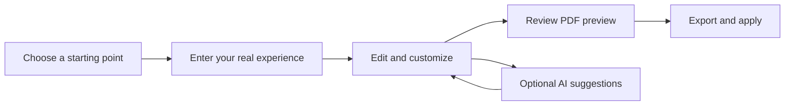
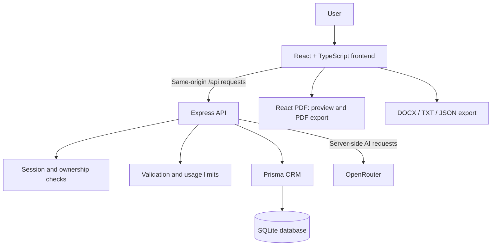

<div align="center">


# CV Creator Pro

### Your experience. Clearly presented.

Build a polished resume, improve your wording with AI, and prepare for your next opportunity — in one workspace.

<p>
  
  
  
  
  
</p>

<p>
  <a href="#quick-start"></a>
  <a href="#features"></a>
  <a href="#architecture"></a>
  <a href="https://github.com/AMINE-IBRA/CV-CREATAOR-AND-FREINDLY-ATS/issues"></a>
</p>

**12 resume templates · Live PDF preview · AI writing tools · PDF & Word exports**

</div>

---

## Overview

CV Creator Pro is a full-stack resume-building application with an editable document workspace, AI-assisted writing, cover letters, and career preparation tools. Start with a blank resume, import an existing document, or turn your own experience into a first draft with AI.

The project runs locally with a React frontend, an Express API, and a SQLite database. Production billing and email integrations remain to be connected; see [deployment readiness](#deployment-readiness).

## Features

### Build and customize

- **Flexible starting points:** create from scratch, generate an AI draft, import PDF/DOCX/TXT/JSON, or copy an existing resume.
- **Complete resume sections:** personal details, experience, education, skills, projects, certifications, languages, and awards.
- **Optional sections:** publications, volunteering, interests, and references.
- **12 layouts:** customize colors, typography, spacing, page size, section order, and visibility.
- **Autosave and recovery:** serialized saves, local draft recovery, and undo/redo support.

### Preview and export

- **Live PDF preview** uses the same document renderer as the downloaded PDF.
- **Selectable text** and automatic pagination, including long resumes.
- **PDF, DOCX, TXT, and JSON** exports; some features depend on the selected plan.
- **A4 and US Letter** page sizes.
- **Latin and Arabic PDF text** with bundled Noto Arabic fonts. Use DOCX or TXT for other scripts.

### Write with AI

- Generate professional summaries and improve experience descriptions.
- Review resume content and compare it with a job description.
- Identify relevant keywords and prepare interview questions.
- Create a tailored resume copy while preserving the original.
- Draft cover letters and review suggestions before applying them.

> AI runs through OpenRouter and requires a server-side API key with available provider capacity. Resume/job text needed for an action is sent to the provider. Review all generated content for accuracy. Match scores are application estimates, not employer ATS results or guarantees of acceptance.

### Manage your workspace

- Account registration, login, profile settings, and password changes.
- Saved resumes, cover letters, and AI activity history.
- Cookie-based sessions, document ownership checks, request validation, and usage limits.
- Development plan previews for trying paid-feature entitlements locally without a payment.

## The workflow



## Architecture



The browser handles the editing interface and document generation. The API manages accounts, persisted documents, access rules, uploads, and AI requests. In development, Vite proxies `/api` to the backend. In production, Express can serve the built frontend and API together.

<details>
<summary><strong>Technology stack</strong></summary>

- **Frontend:** React 19, TypeScript, Vite, React Router.
- **Styling:** Tailwind CSS and Lucide icons.
- **Backend:** Node.js, Express, Zod input validation.
- **Storage:** Prisma ORM with SQLite and checked-in migrations.
- **Authentication:** bcrypt password hashes and opaque HttpOnly session cookies.
- **PDF generation:** `@react-pdf/renderer`.
- **Word generation:** `docx`.
- **File extraction:** `pdf-parse` and Mammoth, with Multer upload handling.
- **AI gateway:** OpenRouter.
- **Verification:** Node test runner, TypeScript builds, and Oxlint.

</details>

## Quick start

### 1. Clone and install

Use **Node.js 22.13 or newer**; Node.js 24 is recommended.

```bash
git clone https://github.com/AMINE-IBRA/CV-CREATAOR-AND-FREINDLY-ATS.git
cd CV-CREATAOR-AND-FREINDLY-ATS
npm run install:all
```

### 2. Configure your environment

Copy these example files using your editor or file manager:

```text
server/.env.example  →  server/.env
client/.env.example  →  client/.env
```

For PowerShell:

```powershell
Copy-Item server/.env.example server/.env
Copy-Item client/.env.example client/.env
```

For macOS/Linux:

```bash
cp server/.env.example server/.env
cp client/.env.example client/.env
```

Keep an existing `.env` if you have already configured the project. Add your OpenRouter key to **`server/.env`** when you want to enable AI. Manual editing and document exports do not require an AI key.

### 3. Prepare the database

For a fresh checkout, generate the Prisma client and apply the existing migrations:

```bash
npm run db:generate
npm run prisma:deploy --prefix server
```

### 4. Start the app

```bash
npm run dev
```

- **Application:** [http://localhost:5173](http://localhost:5173)
- **API health:** [http://localhost:3001/api/health](http://localhost:3001/api/health)

Create an account and start your first resume. Localhost links work only while the app is running on your computer.

<details>
<summary><strong>Run the built preview instead</strong></summary>

```bash
npm run build
npm run preview
```

The built preview also runs at `http://localhost:5173`. Stop any existing development/preview instance before starting another on the same ports. Press Ctrl+C in the launching terminal to stop it.

</details>

## Configuration

### Server — `server/.env`

```dotenv
NODE_ENV=development
HOST=127.0.0.1
PORT=3001
CLIENT_URL=http://localhost:5173
DATABASE_URL=file:./dev.db
OPENROUTER_API_KEY=
OPENROUTER_MODEL=openai/gpt-4o-mini
OPENROUTER_JSON_MODE=true
MAX_FILE_SIZE_MB=10
```

- **`DATABASE_URL`** points to the SQLite database; relative paths resolve from the Prisma schema directory.
- **`CLIENT_URL`** is the permitted frontend origin. Set it to the actual HTTPS origin in production.
- **`OPENROUTER_API_KEY`** belongs only on the server. Never expose it through a `VITE_` variable.
- **`OPENROUTER_MODEL`** selects the model; availability and costs depend on the provider.
- **`HOST` / `PORT`** control the API listener. Hosted environments may require `HOST=0.0.0.0` and their assigned port.
- **`TRUST_PROXY=1`** is available when operating behind a trusted reverse proxy.

### Client — `client/.env`

```dotenv
VITE_API_URL=/api
```

Same-origin requests keep the frontend and session cookies on one origin. `.env` files, local databases, dependencies, and generated output are excluded by `.gitignore`.

## Project map

```text
CV-CREATAOR-AND-FREINDLY-ATS/
├── client/
│   ├── public/                 # Icons and bundled fonts
│   ├── src/
│   │   ├── components/         # Layouts, creation wizard, PDF templates
│   │   ├── contexts/           # Authentication and notifications
│   │   ├── lib/                # API client, autosave, exports, layout rules
│   │   ├── pages/              # Editor, dashboard, career tools, settings
│   │   └── types/              # Resume models and normalization
│   └── tests/                  # Document generation tests
├── server/
│   ├── prisma/                 # Database schema and migrations
│   ├── src/
│   │   ├── lib/                # Configuration, validation, data access
│   │   ├── middleware/         # Authentication and rate limits
│   │   ├── routes/             # Accounts, resumes, AI, uploads, cover letters
│   │   └── services/           # OpenRouter integration
│   └── tests/                  # API integration tests
├── scripts/                    # Development, preview, document test runners
└── README.md
```

## Quality checks

```bash
npm run build
npm test
npm run lint
```

The automated suite includes **15 backend integration tests** and **4 document tests**. Backend tests use an isolated SQLite database and mocked AI responses. Document tests exercise all thirteen templates, long-document pagination, section normalization, and saved payloads.

Browser verification during development covered registration, save/reload, delayed-save handling, document downloads, file imports, cover-letter editing, and mobile navigation. These are development verification results, not a continuously running CI status badge.

<details>
<summary><strong>Useful commands</strong></summary>

```bash
npm run dev                              # Frontend + API for development
npm run build                            # Compile both applications
npm run preview                          # Run the compiled local preview
npm start                                # Run the compiled server
npm run db:generate                      # Generate Prisma client
npm run prisma:deploy --prefix server    # Apply checked-in migrations
npm run db:migrate                       # Author development migrations
npm run test:documents                   # Run document tests only
```

`CV_QA_OUTPUT` selects the document-test output directory. `CV_TEST_TMPDIR` selects the backend-test temporary directory when needed.

</details>

<details>
<summary><strong>Existing database upgrades</strong></summary>

Back up an existing database before changing its schema. Older installations created tables without migration history and need a verified baseline before migration deployment. Do not reset a populated database to silence migration errors.

Inspect migration status from the server directory:

```bash
cd server
npx prisma migrate status
```

The original database upgraded during this project's completion has already been baselined. Fresh clones should use the normal migration deployment steps above.

</details>

## Deployment readiness

The application is available for local use. Public deployment requires environment-specific setup:

- [ ] Select hosting with a Node.js runtime and persistent database storage.
- [ ] Configure HTTPS, production origin, listener settings, and environment secrets.
- [ ] Apply database migrations and establish backups.
- [ ] Connect billing and verified payment events before selling subscriptions.
- [ ] Connect email delivery for production password recovery.
- [ ] Replace legal-page operator/contact details with the actual service information.
- [ ] Repeat account, export, AI, and integration checks in the hosted environment.

Build with `npm run build`, then run `npm start` with **`NODE_ENV=production`**. The server serves `client/dist` in production. Keep SQLite on a durable volume; moving to PostgreSQL requires a deliberate schema/migration change.

**Local plan switching and local password-reset links are development features.** They do not process real payments or send production emails. OAuth sign-in is not integrated.

## Document compatibility

Text-based PDFs make content selectable and extractable. ATS parsing still varies between employers and systems; use a simple single-column template when parsing simplicity matters. Scanned/image-only PDFs require OCR before their text can be imported.

Arabic PDF text uses bundled Noto Sans Arabic fonts. The interface itself is currently in English.

## Contributing

Found a bug or have a feature idea? [Open an issue](https://github.com/AMINE-IBRA/CV-CREATAOR-AND-FREINDLY-ATS/issues) with a clear description, reproduction steps, and redacted screenshots where helpful. Run the build and relevant tests before proposing code changes.

## Credits and licensing

Built and maintained in [AMINE-IBRA's repository](https://github.com/AMINE-IBRA/CV-CREATAOR-AND-FREINDLY-ATS).

Noto Sans Arabic fonts are distributed under the [SIL Open Font License](client/public/fonts/OFL.txt). Other dependencies retain their respective licenses. This repository does not currently declare a project-wide license.

---

<div align="center">

**Make your next application clearer.**

[Get started](#quick-start) · [Explore the architecture](#architecture) · [Report an issue](https://github.com/AMINE-IBRA/CV-CREATAOR-AND-FREINDLY-ATS/issues)

</div>
